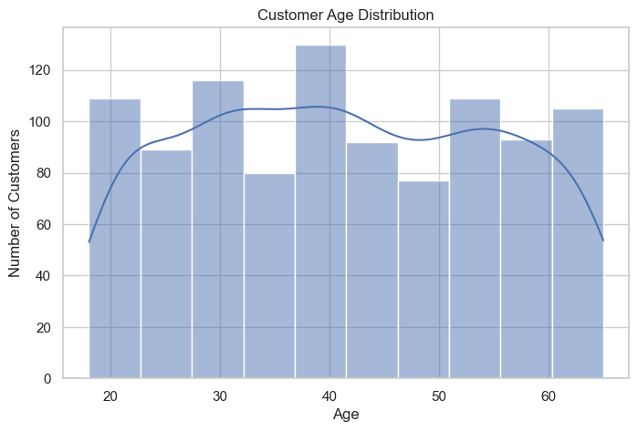
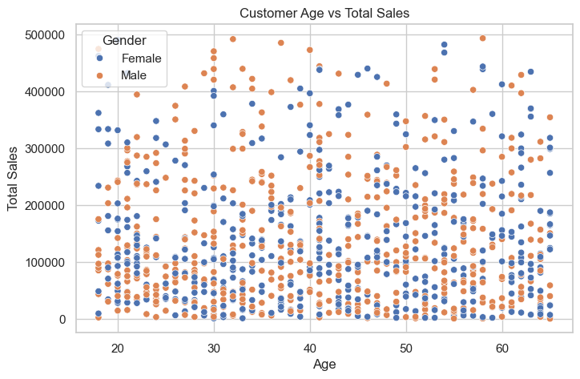
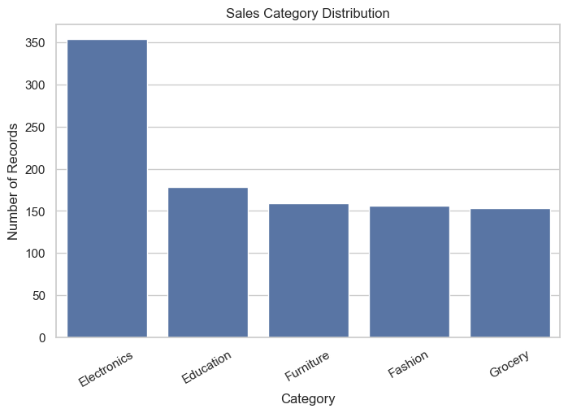
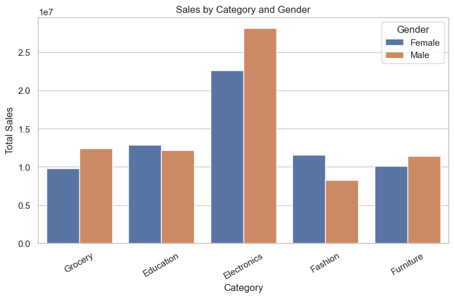
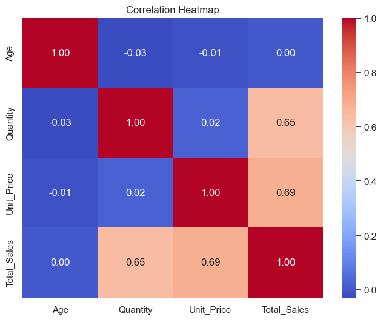
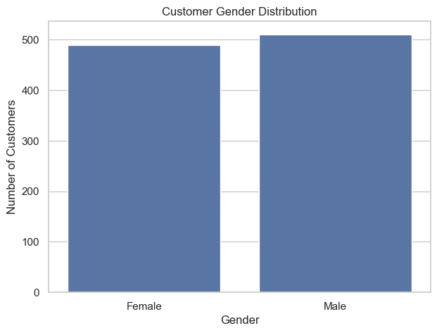
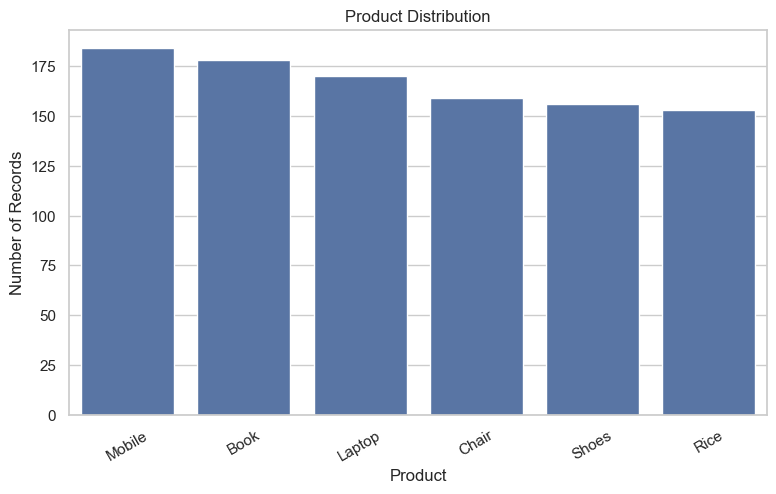
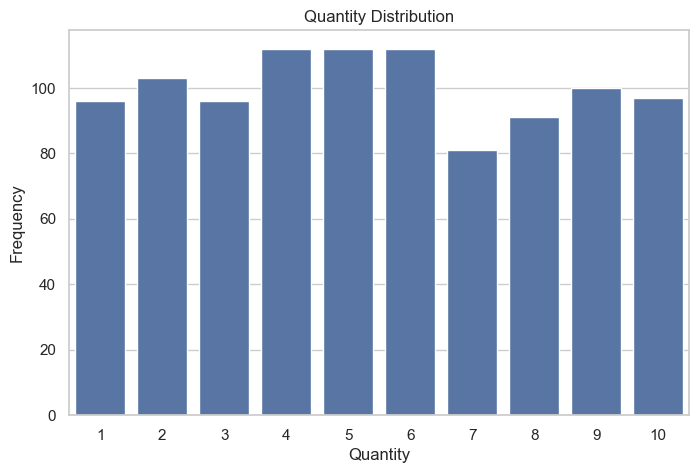

# 📊 Sales Data Analysis – Exploratory Data Analysis & Business Intelligence

### ApexPlanet Data Analytics Internship | Task 2

---

## 📌 Project Overview

This project focuses on exploring and analyzing a sales dataset to understand customer behavior, product performance, and sales patterns.

As part of my ApexPlanet Data Analytics Internship, I worked on data cleaning, preprocessing, Exploratory Data Analysis (EDA), statistical analysis, SQL-based business analysis, and dashboard development.

I used Python to explore and analyze the dataset, PostgreSQL to answer business-related questions, and Microsoft Excel to create a Sales Analytics Dashboard.

The main objective was to transform raw sales data into meaningful information that can help in understanding business performance and supporting data-driven decisions.

## 🎯 Project Objectives

- Understand the structure and characteristics of the dataset.
- Identify and handle missing values and duplicate records.
- Perform data cleaning and preprocessing using Python.
- Conduct descriptive statistical analysis.
- Explore data using different visualizations.
- Analyze relationships between multiple variables.
- Answer business questions using SQL queries.
- Develop a Sales Analytics Dashboard using Microsoft Excel.

## 📂 Dataset Description

The project uses a structured sales transaction dataset containing **1,000 records and 12 original columns**.

The dataset includes information about orders, customers, products, quantities, and sales amounts.

### Dataset Attributes

| Column | Description |
|---|---|
| Order_ID | Order reference number |
| Order_Date | Date of the order |
| Customer_ID | Customer identification |
| Customer_Name | Customer name |
| Age | Customer age |
| Gender | Customer gender |
| City | Customer location |
| Product | Purchased product |
| Category | Product category |
| Quantity | Number of units purchased |
| Unit_Price | Price per unit |
| Total_Sales | Total sales amount |

## 🛠️ Tools and Technologies

| Technology | Purpose |
|---|---|
| Python | Data analysis and preprocessing |
| Pandas | Data manipulation and cleaning |
| NumPy | Numerical operations |
| Matplotlib | Data visualization |
| Seaborn | Statistical visualization |
| Jupyter Notebook | Python development environment |
| PostgreSQL | SQL-based business analysis |
| Microsoft Excel | Dashboard development |

## 🔍 Project Workflow

### 1. Data Understanding

- Loaded the dataset using Pandas.
- Examined the first few records and dataset dimensions.
- Checked column names and data types.
- Reviewed numerical summaries.

### 2. Data Quality Assessment

During the initial dataset inspection, the following issues were identified:

| Data Quality Check | Observation |
|---|---:|
| Total Records | 1,000 |
| Total Original Columns | 12 |
| Missing Age Values | 20 |
| Missing City Values | 13 |
| Completely Duplicated Rows | 0 |
| Additional Repeated Order_ID Occurrences | 8 |
| Potential High-Value Outliers | 19 |
| Unique Customer IDs | 947 |

Repeated Order_ID values were flagged for investigation rather than automatically deleted.

Potential outliers were identified using the Interquartile Range (IQR) method and were not automatically treated as errors.

### 3. Data Cleaning and Preprocessing

The following steps were performed:

- Handled missing Age values using median imputation.
- Replaced missing City values with "Unknown".
- Standardized text formatting in relevant columns.
- Converted Order_Date into a proper date format.
- Checked for completely duplicated records.
- Flagged repeated Order_ID values.
- Examined potential outliers.
- Verified Total_Sales against Quantity × Unit_Price.

### 4. Feature Engineering

Created additional columns to support further analysis:

- `Order_Year`
- `Order_Month`
- `Age_Group`
- `Duplicate_Order_ID_Flag`

### 5. Exploratory Data Analysis

Performed descriptive, univariate, and multivariate analysis.

**Descriptive Statistical Analysis:**
- Mean
- Median
- Mode
- Standard Deviation
- Minimum and Maximum
- Count

**Univariate Analysis:**
- Age distribution
- Gender distribution
- Product category distribution
- Product distribution
- Quantity distribution

**Multivariate Analysis:**
- Age vs Total Sales
- Category and Gender Sales
- Correlation analysis using a heatmap
- Relationships between numerical variables

## 📈 EDA Visualizations

The following charts were generated during the analysis and are available in the `Charts` folder.

### Age Distribution


### Age vs Total Sales


### Category Distribution


### Category and Gender Sales


### Correlation Heatmap


### Gender Distribution


### Product Distribution


### Quantity Distribution


## 🗄️ SQL Business Analysis

PostgreSQL was used to answer important business-related questions.

The analysis focused on:

1. Total sales by product category.
2. Products generating the highest sales.
3. City-wise sales performance.
4. Monthly sales trends.
5. Gender-wise sales contribution.
6. Average sales by product category.
7. Products with the highest total quantity sold.

SQL concepts used:

- SELECT
- WHERE
- GROUP BY
- ORDER BY
- SUM()
- AVG()
- COUNT()

The SQL queries and their available result files are organized in the repository.

## 📊 Sales Analytics Dashboard – Excel

A static Sales Analytics Dashboard was developed using Microsoft Excel to present important business metrics and sales comparisons.

### Key Performance Indicators (KPIs)

- **Total Sales:** Overall sales amount.
- **Total Records:** Total number of transaction records.
- **Unique Customers:** Number of distinct customers.
- **Average Sales:** Average sales amount per record.

### Dashboard Visualizations

- Monthly Sales Trend
- Category-wise Sales
- City-wise Sales
- Top 5 Products by Sales
- Gender-wise Sales

The dashboard uses a black and green color combination to provide a clean and professional appearance.

## 💡 Key Observations

The initial data-quality assessment highlighted:

- The dataset contains 1,000 sales records.
- There are 947 unique Customer IDs.
- Missing values were found in Age and City.
- No completely duplicated rows were identified.
- Some Order_ID values appeared more than once.
- Potential high-value outliers were identified using the IQR method.
- Additional features were created for time-based and customer-segment analysis.

Final business findings are based on the actual SQL query results and dashboard analysis.

## 📁 Project Structure

```text
ApexPlanet-Task2-EDA-Business-Intelligence/
│
├── Charts/
│   ├── Age_Distribution.png
│   ├── Age_vs_Total_Sales.png
│   ├── Category_Distribution.png
│   ├── Category_Gender_Sales.png
│   ├── Correlation_Heatmap.png
│   ├── Gender_Distribution.png
│   ├── Product_Distribution.png
│   └── Quantity_Distribution.png
│
├── SQL_Results/
│
├── Cleaned_Sales_Dataset.xlsx
├── Descriptive_Statistics.csv
├── EDA_Report.pdf
├── README.md
├── SQL_Queries.sql
├── Sales_Analytics_Dashboard.xlsx
└── Task2_EDA.ipynb
```

## 📚 Project Files Description

| File / Folder | Description |
|---|---|
| `Charts/` | Contains EDA visualizations |
| `SQL_Results/` | Folder for SQL query results |
| `Cleaned_Sales_Dataset.xlsx` | Cleaned sales dataset |
| `Descriptive_Statistics.csv` | Statistical analysis results |
| `EDA_Report.pdf` | Detailed EDA report |
| `SQL_Queries.sql` | SQL business analysis queries |
| `Sales_Analytics_Dashboard.xlsx` | Excel sales dashboard |
| `Task2_EDA.ipynb` | Python EDA notebook |

## 🎓 Learning Outcomes

Through this project, I gained practical experience in:

- Data cleaning and preprocessing.
- Exploratory Data Analysis using Python.
- Statistical analysis and data visualization.
- Writing SQL queries for business questions.
- Understanding relationships between variables.
- Creating dashboards using Microsoft Excel.
- Organizing and documenting projects using GitHub.

## 🏁 Conclusion

This project gave me an opportunity to apply data analytics concepts to a sales dataset and understand the complete process of working with data.

From identifying data-quality issues to performing analysis, writing SQL queries, and creating an Excel dashboard, each step helped me improve my practical understanding of data analytics.

It was a valuable learning experience that strengthened my knowledge of Python, SQL, data visualization, and Business Intelligence.

---

### 👩‍💻 Project Information

**Internship:** ApexPlanet Data Analytics Internship  
**Task:** Task 2 – EDA and Business Intelligence  
**Project:** Sales Data Analysis  
**Tools:** Python, Pandas, NumPy, Matplotlib, Seaborn, PostgreSQL, Microsoft Excel

**#ApexPlanet #DataAnalytics #Python #SQL #EDA #Excel #BusinessIntelligence**
